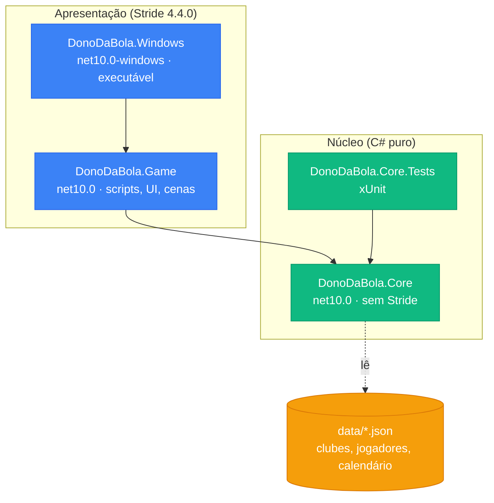

# Fase 1 – Base do repositório: plano de implementação

> **Para o Claude:** SUB-SKILL OBRIGATÓRIA: use executing-plans para implementar este plano tarefa por tarefa.

**Objetivo:** preparar a solução com o Core (C# puro), os testes, o `.gitignore`, o README e o primeiro commit, sem nenhuma funcionalidade de jogo.

**Arquitetura:** a Stride (apresentação) referencia o `DonoDaBola.Core`; o Core não conhece a Stride e lê os dados iniciais em JSON. Os testes referenciam só o Core.

**Stack:** .NET 10 (SDK 10.0.100), Stride 4.4.0, xUnit, solução `DonoDaBola.slnx`.

---

## Situação atual (análise)

| Item | Encontrado |
|---|---|
| Solução | `DonoDaBola.slnx` (XML, não `.sln`), com `DonoDaBola.Game` e `DonoDaBola.Windows` (startup) |
| `DonoDaBola.Game` | `net10.0`, pacotes Stride 4.4.0 (Engine, UI, Physics...), `RootNamespace=DonoDaBola` |
| `DonoDaBola.Windows` | `net10.0-windows`, WinExe, saída em `Bin\Windows\<Config>\`, referencia o Game |
| SDK instalado | 10.0.100 |
| `.gitignore` | já existe (básico); será substituído |
| Git | ainda não inicializado |

**Divergência com o CLAUDE.md:** o comando `dotnet build DonoDaBola.sln` não funciona (não há `.sln`). Proposta: trocar por `dotnet build DonoDaBola.slnx` no CLAUDE.md (edição de uma linha).

## Árvore proposta

```
DonoDaBola/
├── DonoDaBola.slnx
├── CLAUDE.md
├── README.md                      (novo)
├── .gitignore                     (substituído)
├── docs/
│   ├── GDD.md
│   ├── GDD_Dono_da_Bola_esboco.pdf
│   └── plans/
├── data/                          (novo; JSON de clubes, jogadores e calendário)
│   └── .gitkeep
├── DonoDaBola.Core/               (novo; classlib net10.0, sem Stride)
│   └── DonoDaBola.Core.csproj
├── DonoDaBola.Core.Tests/         (novo; xUnit net10.0)
│   ├── DonoDaBola.Core.Tests.csproj
│   └── SmokeTests.cs
├── DonoDaBola.Game/               (Stride; ganha ProjectReference para o Core)
└── DonoDaBola.Windows/            (Stride; inalterado, recebe o Core por transitividade)
```

Decisões:
- **Core sem código.** O `Class1.cs` do template é apagado; a primeira classe nasce com a primeira funcionalidade.
- **`data/` na raiz**, vazia (só `.gitkeep`). A cópia dos JSON para a saída do jogo será configurada quando o primeiro arquivo existir.
- **Sem `Directory.Build.props`/`global.json`:** só há três projetos .NET comuns; adicionar se a configuração começar a se repetir.

## Referências entre projetos



| Projeto | Referencia |
|---|---|
| DonoDaBola.Windows | DonoDaBola.Game (já existe) |
| DonoDaBola.Game | **DonoDaBola.Core** (novo) |
| DonoDaBola.Core.Tests | DonoDaBola.Core |
| DonoDaBola.Core | nada |

---

### Tarefa 1: Projeto DonoDaBola.Core

**Arquivos:** criar `DonoDaBola.Core/DonoDaBola.Core.csproj`; apagar `DonoDaBola.Core/Class1.cs`.

```powershell
dotnet new classlib -n DonoDaBola.Core -f net10.0 -o DonoDaBola.Core
Remove-Item DonoDaBola.Core/Class1.cs
dotnet sln DonoDaBola.slnx add DonoDaBola.Core/DonoDaBola.Core.csproj
```

Esperado: csproj com `<TargetFramework>net10.0</TargetFramework>`, `ImplicitUsings` e `Nullable` habilitados, nenhum `PackageReference`.

### Tarefa 2: Referência Game → Core

**Arquivos:** modificar `DonoDaBola.Game/DonoDaBola.Game.csproj` (novo `ItemGroup` com `ProjectReference`).

```powershell
dotnet add DonoDaBola.Game/DonoDaBola.Game.csproj reference DonoDaBola.Core/DonoDaBola.Core.csproj
```

### Tarefa 3: Projeto de testes com um teste de fumaça

**Arquivos:** criar `DonoDaBola.Core.Tests/DonoDaBola.Core.Tests.csproj` e `DonoDaBola.Core.Tests/SmokeTests.cs`; apagar `UnitTest1.cs`.

```powershell
dotnet new xunit -n DonoDaBola.Core.Tests -f net10.0 -o DonoDaBola.Core.Tests
Remove-Item DonoDaBola.Core.Tests/UnitTest1.cs
dotnet add DonoDaBola.Core.Tests/DonoDaBola.Core.Tests.csproj reference DonoDaBola.Core/DonoDaBola.Core.csproj
dotnet sln DonoDaBola.slnx add DonoDaBola.Core.Tests/DonoDaBola.Core.Tests.csproj
```

O teste de fumaça valida a configuração e já protege a regra de arquitetura (Core sem Stride):

```csharp
using System.Reflection;

namespace DonoDaBola.Core.Tests;

public class SmokeTests
{
    // Valida a configuração: o Core compila, é carregado pelos testes e não referencia a Stride.
    [Fact]
    public void CoreLoadsWithoutStride()
    {
        var core = Assembly.Load("DonoDaBola.Core");

        Assert.DoesNotContain(core.GetReferencedAssemblies(), a => a.Name!.StartsWith("Stride"));
    }
}
```

Executar: `dotnet test DonoDaBola.Core.Tests` → esperado: 1 aprovado.

### Tarefa 4: `.gitignore` (substitui o atual)

```gitignore
# Build (.NET / Stride)
[Bb]in/
[Oo]bj/
TestResults/

# Caches da Stride
Cache/
*.sdpkg.user

# Visual Studio / Rider / VS Code
.vs/
.idea/
.vscode/
*.user
*.suo
*.userprefs

# Diversos
*.log
Thumbs.db
```

### Tarefa 5: `README.md`

```markdown
# Dono da Bola

Jogo de gerenciamento de futebol (estilo Brasfoot / Football Manager) baseado no Brasileirão Série A 2026.
O jogador é ao mesmo tempo dono/presidente e técnico do clube, com autonomia total.

Trabalho da disciplina Jogos e Entretenimento Digital – Bacharelado em Ciência da Computação, UNEMAT (Campus Barra do Bugres).

## Integrantes

- Hugo
- Mateus
- Renan

## Requisitos

- Windows 10/11
- [.NET SDK 10](https://dotnet.microsoft.com/download)
- [Stride 4.4.0](https://www.stride3d.net/) (Game Studio, para editar cenas e assets)

## Estrutura

| Pasta | Conteúdo |
|---|---|
| `DonoDaBola.Core` | Lógica do jogo em C# puro (sem Stride) |
| `DonoDaBola.Core.Tests` | Testes unitários do Core (xUnit) |
| `DonoDaBola.Game` | Projeto Stride: scripts, interface e cenas |
| `DonoDaBola.Windows` | Executável para Windows |
| `data` | Dados iniciais em JSON (clubes, jogadores, calendário) |
| `docs` | Game Design Document (`GDD.md`) e planos |

## Como compilar

    dotnet build DonoDaBola.slnx

Feche o Game Studio antes, se o build acusar arquivo travado.
O executável fica em `Bin/Windows/Debug/`.

## Como testar

    dotnet test DonoDaBola.Core.Tests

## Documentação

O design completo está em [docs/GDD.md](docs/GDD.md).
```

### Tarefa 6: `data/` e correção do CLAUDE.md

- Criar `data/.gitkeep` (vazio).
- Em `CLAUDE.md`, trocar `dotnet build DonoDaBola.sln` por `dotnet build DonoDaBola.slnx`.

### Tarefa 7: Verificação

```powershell
dotnet build DonoDaBola.slnx
dotnet test DonoDaBola.Core.Tests
```

Esperado: build sem erros nos 4 projetos; 1 teste aprovado. Falhou → systematic-debugging antes de qualquer correção.

### Tarefa 8: Git e GitHub

```powershell
git init
git add .
git status   # conferir que Bin/, obj/, .vs/ e *.user ficaram de fora
git commit -m "Prepara a base do repositório: Core, testes, GDD em Markdown, README e .gitignore"
git branch -M main
git remote add origin https://github.com/hugo-v-a/DonoDaBola.git
git push -u origin main
```
