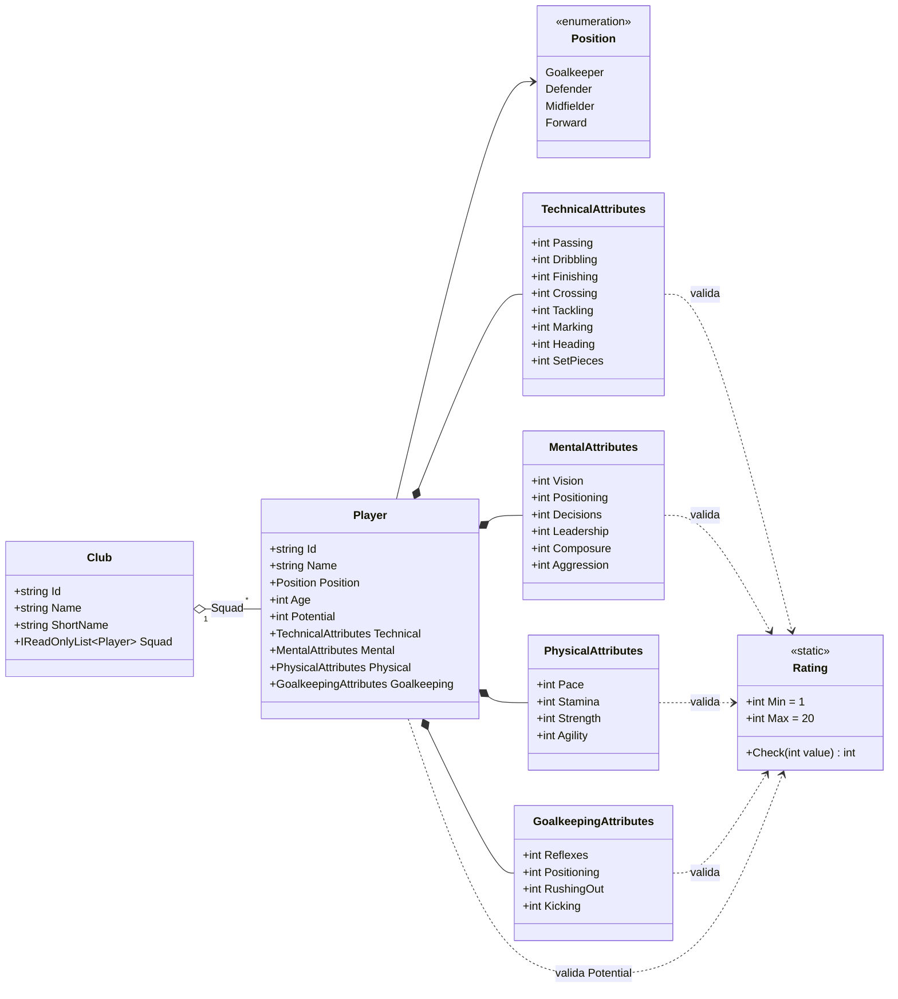

# M1 / PR 1 – Modelos e gerador aleatório: plano de implementação

> **Para o Claude:** SUB-SKILL OBRIGATÓRIA: use executing-plans para implementar este plano tarefa por tarefa.

**Objetivo:** entregar `Player`, `Club` e atributos validados (1–20), e fixar a convenção de aleatoriedade com seed, para destravar o Renan (JSON e gerador de atributos) e o Mateus (dados falsos na UI).

**Arquitetura:** records imutáveis no Core, com validação no `init` de cada atributo. Desserialização direta com `System.Text.Json`, sem DTOs. Aleatoriedade: `System.Random` criado com seed e injetado (sem interface própria; decisão do Hugo em 15/10).

**Stack:** C# 14 / .NET 10, xUnit, `System.Text.Json` (já vem no .NET).

**Branch:** `feature/modelos` → PR para `main`.

---

## Decisões

| Decisão | Escolha | Motivo |
|---|---|---|
| Namespace | Tudo em `DonoDaBola.Core` por enquanto | Poucos tipos; subpastas quando o Core crescer (ex.: `Simulation` no PR 2) |
| Tipos | `record` com propriedades `required` + `init` | Imutável, igualdade por valor, `new X { ... }` legível e compatível com JSON |
| Validação | `init => field = Rating.Check(value)` (palavra-chave `field` do C# 14) | Rejeita fora de 1–20 na criação, inclusive ao ler JSON; `required` impede esquecer um atributo |
| Id | `string` (ex.: `"clu01-p07"`) | Fácil de escrever à mão no JSON do Renan |
| Posição no JSON | texto em português (`"Goleiro"`, `"Defensor"`, `"Meio-campista"`, `"Atacante"`) via `JsonStringEnumMemberName`; no código fica em inglês | JSON legível para o grupo; código segue a convenção do CLAUDE.md |
| Potencial | mesma escala 1–20 | Consistente com os atributos (GDD §6) |
| Goleiro | todo jogador tem os quatro grupos | Igual ao FM; linha tem atributos de goleiro baixos |
| Idade | sem validação neste PR | Não pedido; adicionar se o gerador do Renan precisar |
| Aleatório | `System.Random` com seed, recebido por parâmetro | Já faz o necessário; mesma seed = mesma sequência |

## Diagrama de classes

Mapeamento GDD → código: passe `Passing`, drible `Dribbling`, finalização `Finishing`, cruzamento `Crossing`, desarme `Tackling`, marcação `Marking`, cabeceio `Heading`, bola parada `SetPieces`; visão `Vision`, posicionamento `Positioning`, decisão `Decisions`, liderança `Leadership`, frieza `Composure`, agressividade `Aggression`; velocidade `Pace`, resistência `Stamina`, força `Strength`, agilidade `Agility`; reflexo `Reflexes`, posicionamento `Positioning`, saída do gol `RushingOut`, jogo com os pés `Kicking`.

## Arquivos

| Arquivo | Conteúdo |
|---|---|
| `DonoDaBola.Core/Rating.cs` | `Rating` (limites e `Check`) |
| `DonoDaBola.Core/Attributes.cs` | os quatro records de atributos |
| `DonoDaBola.Core/Player.cs` | `Position` e `Player` |
| `DonoDaBola.Core/Club.cs` | `Club` |
| `DonoDaBola.Core.Tests/TestPlayers.cs` | fábrica de jogadores para os testes (reaproveitada no PR 2) |
| `DonoDaBola.Core.Tests/ModelTests.cs` | testes dos modelos |
| `docs/progresso/hugo.md` | documento de progresso |

## Testes (TDD: cada um escrito e visto falhando antes do código)

**ModelTests**
1. `Rating_AcceptsBounds` – 1 e 20 aceitos.
2. `Rating_RejectsOutOfRange` – 0, 21 e -5 lançam `ArgumentOutOfRangeException`, com o nome do atributo na mensagem.
3. `EachAttributeGroup_RejectsOutOfRange` – um valor inválido em cada grupo (técnico, mental, físico, goleiro) e no potencial é rejeitado.
4. `Player_DeserializesFromJson` – um jogador em JSON (posição como texto) vira `Player` com os valores certos.
5. `Player_JsonWithOutOfRangeAttribute_Throws` – JSON com `"Passing": 25` é rejeitado.
6. `Club_HoldsSquad` – clube criado com elenco expõe os jogadores.

Sem testes de `System.Random` (é da biblioteca padrão); a reprodutibilidade é coberta no PR 2 pelo teste "mesma seed = mesma partida".

**Já existente:** `SmokeTests.CoreLoadsWithoutStride` continua passando.

## Passos

1. Para cada grupo de testes acima: escrever o teste → `dotnet test DonoDaBola.Core.Tests` (falha) → código mínimo → teste passa.
2. Verificação: `dotnet build DonoDaBola.slnx` e `dotnet test DonoDaBola.Core.Tests` sem falhas.
3. Revisão do próprio código (requesting-code-review).
4. Commits pequenos em português:
   - `feat(core): adiciona atributos validados e modelos Player e Club`
   - `docs: adiciona progresso do Hugo`
5. `git push -u origin feature/modelos` e `gh pr create --base main` com título e descrição em português (como usar os modelos).

## Fora deste PR

Escalação 4-4-2 e motor de eventos (PR 2). Moral, condição física, contrato, finanças, cartões e lesões (M2+).
