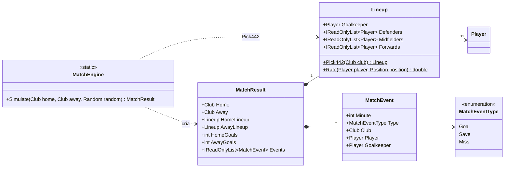

# M1 / PR 2 – Escalação 4-4-2 e motor de eventos: plano de implementação

> **Para o Claude:** SUB-SKILL OBRIGATÓRIA: use executing-plans para implementar este plano tarefa por tarefa.

**Objetivo:** simular uma partida de 90 minutos entre dois `Club` e devolver um `MatchResult` com o placar e eventos estruturados, prontos para a narração do Mateus.

**Arquitetura:** funções estáticas e records imutáveis em `DonoDaBola.Core.Simulation`. A escalação escolhe os 11 melhores num 4-4-2. O motor percorre 90 intervalos de 1 minuto: compara a força dos setores, sorteia posse, chance, finalização e resultado com um `System.Random` recebido por parâmetro.

**Stack:** C# 14 / .NET 10, xUnit. Sem dependências novas.

**Branch:** `feature/simulacao`, criada a partir de `feature/modelos`. O PR aponta para a `main` e só deve ser mesclado depois do PR 1 (ou é rebaseado após o merge dele).

---

## API pública

```csharp
// Escalação automática 4-4-2 (os 11 melhores por posição).
Lineup lineup = Lineup.Pick442(club);

// Partida: mesma seed + mesmos clubes = mesma partida.
MatchResult result = MatchEngine.Simulate(home, away, new Random(42));

result.HomeGoals; result.AwayGoals;
foreach (MatchEvent e in result.Events)          // em ordem de minuto
    // e.Minute, e.Type (Goal | Save | Miss), e.Club (quem finalizou),
    // e.Player (quem finalizou), e.Goalkeeper (goleiro adversário)
```

## Diagrama de classes



## Regras do modelo (calibração inicial; ajuste fino no M4)

| Item | Regra |
|---|---|
| Nota por posição (`Lineup.Rate`) | média de atributos da função. Goleiro: os 4 de goleiro. Defensor: desarme, marcação, cabeceio, posicionamento, força, velocidade. Meio: passe, visão, decisão, drible, resistência. Atacante: finalização, frieza, drible, velocidade, cabeceio. |
| Escalação | 1 GOL, 4 DEF, 4 MEI, 2 ATA, os de maior nota em cada posição. Faltou gente numa posição: completa com o melhor restante nessa nota. Elenco com menos de 11: `ArgumentException`. |
| Força dos setores | defesa = média dos defensores; meio = média dos meio-campistas; ataque = média dos atacantes (notas da posição). |
| Mando | `HomeAdvantage = 1.1` multiplica meio e ataque do mandante. |
| Posse do intervalo | P(mandante) = meio_m / (meio_m + meio_v). |
| Chance | P = `ChanceRate (0,25)` × ataque / (ataque + defesa adversária). Equilíbrio dá ~11 chances por jogo. |
| Finalizador | sorteado entre os 10 de linha, com peso por posição (ATA 3, MEI 1,5, DEF 0,5) × finalização. |
| No alvo | P = 0,4 + 0,3 × (r − 0,5), com r = finalização / (finalização + média da defesa adversária). Fora do alvo: `Miss`. |
| Gol | no alvo: P = 1,1 × finalização / (finalização + nota do goleiro). Senão: `Save`. Equilíbrio dá ~2,5 gols por jogo. |

As constantes ficam no topo do `MatchEngine`, marcadas como pontos de calibração.

## Arquivos

| Arquivo | Conteúdo |
|---|---|
| `DonoDaBola.Core/Simulation/Lineup.cs` | `Lineup`, `Pick442`, `Rate` |
| `DonoDaBola.Core/Simulation/MatchResult.cs` | `MatchResult`, `MatchEvent`, `MatchEventType` |
| `DonoDaBola.Core/Simulation/MatchEngine.cs` | `MatchEngine.Simulate` |
| `DonoDaBola.Core.Tests/TestPlayers.cs` | + `CreateClub(id, rating)`: 18 jogadores (2 GOL, 6 DEF, 6 MEI, 4 ATA) |
| `DonoDaBola.Core.Tests/LineupTests.cs` | testes da escalação |
| `DonoDaBola.Core.Tests/MatchEngineTests.cs` | testes do motor |
| `docs/progresso/hugo.md` | atualizado |

## Testes (TDD: cada um escrito e visto falhando antes do código)

**LineupTests**
1. `Pick442_PicksFormation` – 1 goleiro, 4 defensores, 4 meio-campistas e 2 atacantes, todos da posição certa.
2. `Pick442_PicksBestPerPosition` – entre 6 defensores de notas diferentes, entram os 4 melhores.
3. `Pick442_FillsShortPosition` – clube com só 1 atacante ainda escala 11 jogadores distintos.
4. `Pick442_RejectsSquadUnder11`.

**MatchEngineTests**
5. `SameSeed_ProducesSameMatch` – placar e lista de eventos idênticos.
6. `Score_MatchesGoalEvents` – em 200 partidas, gols de cada lado = eventos `Goal` daquele clube.
7. `Events_AreOrderedAndInsideMatch` – minutos entre 1 e 90, em ordem; `Goalkeeper` é o goleiro titular adversário.
8. `StrongerTeam_WinsMostMatches` – 1.000 partidas (seeds 0–999, mando alternado), nota 15 × nota 8: o forte vence mais de 70%.
9. `BalancedTeams_AverageGoalsIsPlausible` – 1.000 partidas entre notas 10 × 10: média entre 1,5 e 3,5.
10. `HomeTeam_HasSmallAdvantage` – nas mesmas 1.000 partidas, o mandante vence mais que o visitante.
11. `Season_SimulatesQuickly` – 380 partidas em menos de 3 s.

**Já existentes:** os 15 do PR 1 continuam passando.

## Passos

1. Para cada grupo de testes: teste → falha → código mínimo → passa.
2. Verificação: `dotnet build DonoDaBola.slnx` e `dotnet test DonoDaBola.Core.Tests`.
3. Revisão do próprio código.
4. Commits: `feat(simulacao): adiciona escalação automática 4-4-2`, `feat(simulacao): adiciona motor de eventos da partida`, `docs: atualiza progresso do Hugo`.
5. `git push -u origin feature/simulacao` e `gh pr create --base main` em português, explicando ao Mateus como percorrer os eventos.

## Fora deste PR

Cartões, lesões, moral, condição física e substituições (M2). Táticas e outras formações (M3). Assistências, acréscimos e eventos de intervalo/fim de jogo: a UI já sabe que a partida tem 90 minutos e intervalo no 45.
