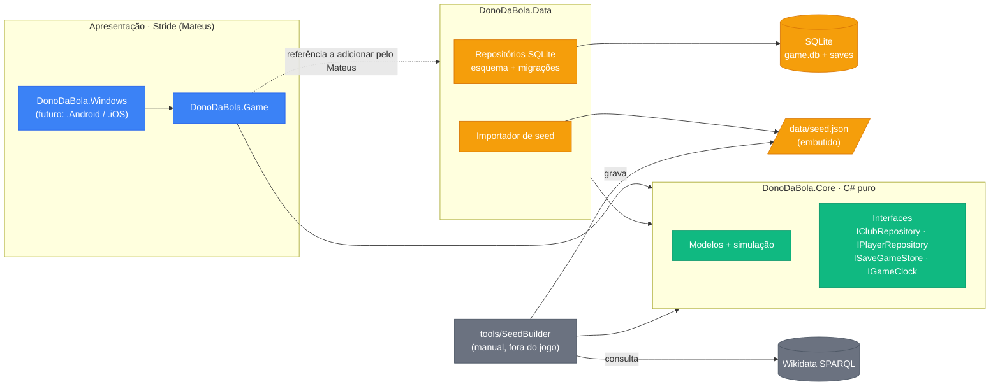

# Persistência SQLite, portabilidade mobile e dados iniciais: plano

> **Para o Claude:** SUB-SKILL OBRIGATÓRIA: use executing-plans para implementar este plano tarefa por tarefa.

**Objetivo:** trocar o JSON por SQLite como fonte de verdade e formato do save, deixar Core e Data prontos para Android/iOS e gerar os 20 clubes genéricos a partir de distribuições derivadas do Wikidata.

**Arquitetura:** o Core define modelos e interfaces (repositórios, save, relógio) e continua sem Stride e sem SQLite. O novo `DonoDaBola.Data` implementa as interfaces com Microsoft.Data.Sqlite. O JSON vira seed embutido no Data. A ferramenta `tools/DonoDaBola.SeedBuilder` roda à mão, fora do jogo: consulta o Wikidata, agrega estatísticas e gera o seed.

**Stack:** .NET 10, Microsoft.Data.Sqlite 10.0.13 (bundle `e_sqlite3`, com nativos para Android e iOS), xUnit, System.Text.Json.

**Base:** pesquisa da Etapa 1 (fontes no fim). Estratégia aprovada em 21/10: o Wikidata entra só como amostra estatística, e todos os jogadores do seed são gerados.

---

## 1. Estado de partida

- `main` em `93d2d64`; PRs #1 a #4 mesclados e nenhum PR aberto.
- Não há branch, PR ou código do Renan nem do Mateus, nem `docs/progresso/mateus.md` ou `renan.md`. Nada a integrar.
- `Player` já está na `main`, com `Age` obrigatório. As mudanças abaixo são compatíveis (seção 4).

## 2. Estrutura e referências

```
DonoDaBola/
├── DonoDaBola.Core/                 net10.0 · modelos, simulação, interfaces (sem Stride, sem SQLite)
├── DonoDaBola.Core.Tests/
├── DonoDaBola.Data/                 net10.0 · SQLite: esquema, repositórios, importador de seed, save
│   └── (seed.json embutido como recurso, vindo de data/seed.json)
├── DonoDaBola.Data.Tests/           SQLite em memória
├── tools/DonoDaBola.SeedBuilder/    console net10.0 · Wikidata → estatísticas → seed (fora do jogo)
├── data/
│   ├── seed.json                    seed publicado (clubes e jogadores fictícios)
│   └── player-stats.json            distribuições agregadas por posição (sem indivíduos)
├── DonoDaBola.Game/  DonoDaBola.Windows/   (Stride, do Mateus; não mexo)
└── docs/decisoes/                   ADRs
```



| Projeto | Referencia | Observação |
|---|---|---|
| Core | nada | Teste arquitetural: nenhum assembly `Stride.*`, `Microsoft.Data.Sqlite*` ou `SQLitePCL*` |
| Data | Core, Microsoft.Data.Sqlite | Teste: nenhum `Stride.*` |
| SeedBuilder | Core | Não é referenciado por nenhum projeto do jogo, então não entra no build mobile |
| Game | Core, **Data** | Sou proibido de mexer no `DonoDaBola.Game.csproj`. **O Mateus adiciona** `<ProjectReference>` ao Data quando for consumir os repositórios (ou eu adiciono com autorização sua) |

O seed vai como `EmbeddedResource` no Data. Assim não depende de caminho de arquivo, o que vale para desktop e mobile.

## 3. Interfaces no Core (contrato do Mateus)

```csharp
namespace DonoDaBola.Core;

public interface IGameClock { DateOnly Today { get; } }

public interface IClubRepository
{
    IReadOnlyList<Club> GetAll();                 // 20 clubes, com elenco
    Club? Get(string id);
}

public interface IPlayerRepository
{
    // Paginação obrigatória: o elenco total tem cerca de 600 jogadores.
    IReadOnlyList<Player> Find(PlayerQuery query);
    int Count(PlayerQuery query);
}
public record PlayerQuery(string? ClubId = null, Position? Position = null, int Offset = 0, int Limit = 50);

public interface ISaveGameStore
{
    IReadOnlyList<string> List();                 // nomes dos slots
    void Save(string slot);                       // copia o banco atual para o slot
    void Load(string slot);                       // restaura o slot sobre o banco atual
    void Delete(string slot);
}
```

O relógio de teste fica nos testes, sem classe extra no Core: `record FixedClock(DateOnly Today) : IGameClock`. O relógio do jogo, que avança a data, entra no M2, junto com o calendário.

**Onde fica o banco:** `SqliteGameDatabase.Open(string directory)` recebe a pasta pronta. No jogo, a Stride passa a pasta gravável do `VirtualFileSystem.ApplicationLocal` (ver seção 11); nos testes, a pasta é em memória. Nada de `Environment.GetFolderPath` nem de caminho fixo.

Alternativa mais simples: um repositório único (`IGameData`) no lugar de dois. Mantive os dois nomes que você sugeriu.

## 4. Modelo `Player`: mudanças compatíveis

| Membro | Antes | Depois |
|---|---|---|
| `BirthDate` | — | **novo e obrigatório** (`required DateOnly`), substitui o `Age`. O banco também exige o campo (`NOT NULL`) |
| `AgeOn(DateOnly date)` | — | **novo**: idade completa na data do jogo (`player.AgeOn(clock.Today)`) |
| `Age` | `required int` | **removido no PR A** (decisão de 21/10: ninguém consumia ainda); use `AgeOn(clock.Today)` |
| `HeightCm` | — | novo `int?`, validado entre 150 e 215 |
| `WeightKg` | — | novo `int?`, validado entre 50 e 120 |
| `PreferredFoot` | — | novo enum `Right` (padrão) / `Left` / `Both`; no JSON: `direito`, `esquerdo`, `ambos` |
| `Nationality` | — | novo `string`, código ISO 3166-1 alfa-2 (`"BR"`), padrão `"BR"`, validado como 2 letras maiúsculas |
| `DataSource` | — | novo enum `Generated` (padrão) / `Wikidata`; no JSON: `gerado`, `wikidata` |

Os testes atuais continuam passando sem alteração, com exceção do aviso de `[Obsolete]` onde `Age` é usado. Esse aviso é suprimido só no `TestPlayers`, até a remoção.

```csharp
public int AgeOn(DateOnly date) =>
    date.Year - BirthDate.Year - (date < BirthDate.AddYears(date.Year - BirthDate.Year) ? 1 : 0);
```

Os testes cobrem aniversário no próprio dia, na véspera e nascimento em 29/02.

## 5. Esquema SQLite (versão 1)

O `PRAGMA user_version` guarda a versão. As migrações são um array de scripts no Data; ao abrir o banco, aplica-se cada script com índice ≥ `user_version`, dentro de uma transação. A conexão abre com `Foreign Keys=True`. As tabelas são `STRICT`, que exigem SQLite 3.37 ou mais novo (o `e_sqlite3` atual atende).

```sql
CREATE TABLE club (
    id          TEXT PRIMARY KEY,
    name        TEXT NOT NULL,
    short_name  TEXT NOT NULL
) STRICT;

CREATE TABLE player (
    id              TEXT PRIMARY KEY,
    club_id         TEXT REFERENCES club(id) ON DELETE SET NULL,   -- NULL = sem clube (mercado, M3)
    name            TEXT NOT NULL,
    position        TEXT NOT NULL CHECK (position IN ('goalkeeper','defender','midfielder','forward')),
    birth_date      TEXT NOT NULL CHECK (birth_date GLOB '[0-9][0-9][0-9][0-9]-[0-9][0-9]-[0-9][0-9]'),
    height_cm       INTEGER CHECK (height_cm BETWEEN 150 AND 215),
    weight_kg       INTEGER CHECK (weight_kg BETWEEN 50 AND 120),
    preferred_foot  TEXT NOT NULL CHECK (preferred_foot IN ('right','left','both')),
    nationality     TEXT NOT NULL CHECK (length(nationality) = 2 AND nationality = upper(nationality)),
    data_source     TEXT NOT NULL CHECK (data_source IN ('wikidata','generated')),
    potential       INTEGER NOT NULL CHECK (potential BETWEEN 1 AND 20),
    -- 22 atributos, um por coluna, todos INTEGER NOT NULL CHECK (x BETWEEN 1 AND 20):
    passing, dribbling, finishing, crossing, tackling, marking, heading, set_pieces,
    vision, positioning, decisions, leadership, composure, aggression,
    pace, stamina, strength, agility,
    gk_reflexes, gk_positioning, gk_rushing_out, gk_kicking
) STRICT;

CREATE INDEX ix_player_club_position ON player(club_id, position);
CREATE INDEX ix_player_position ON player(position);
PRAGMA user_version = 1;
```

- **Atributos em colunas, não em JSON:** permite `CHECK` por atributo e filtros, como "atacantes com finalização ≥ 15" no mercado.
- **Idade não é gravada:** só `birth_date`.
- **Duas camadas de validação:** o Core valida na criação do objeto e o banco valida no `CHECK`, para quem editar o `.db` à mão.
- **Fora da v1:** tabelas de estado (data atual, temporada, partidas, classificação) entram como migração 2 no M2.

## 6. Seed JSON e importador

O formato reaproveita o JSON do `Player` que já existe, com os campos novos:

```json
{
  "Version": 1,
  "Clubs": [
    { "Id": "clu01", "Name": "Esporte Clube Serra Verde", "ShortName": "SVE",
      "Squad": [ { "Id": "clu01-p01", "Name": "Caio Moreira", "Position": "Goleiro",
                   "BirthDate": "1996-04-12", "HeightCm": 191, "WeightKg": 86,
                   "PreferredFoot": "direito", "Nationality": "BR", "DataSource": "gerado",
                   "Potential": 14, "Technical": { … }, "Mental": { … }, "Physical": { … }, "Goalkeeping": { … } } ] }
  ]
}
```

- **Carga inicial:** `SeedImporter.Import(Stream json, SqliteConnection)` desserializa com `RespectNullableAnnotations = true`, valida `version`, `BirthDate` e o elenco mínimo do 4-4-2, e grava tudo numa única transação.
- **Quando roda:** só quando o banco está vazio, na primeira abertura do jogo.
- **Exportação:** `SeedExporter.Export(conn, Stream)` faz o caminho inverso (seção 10).
- **Compatibilidade:** não existe carregador na `main` (o Renan não chegou a começar), então nada é quebrado. O formato JSON do PR #1 continua válido.

## 7. Save

O banco é o save. O `game.db` é a partida em andamento; cada slot é uma cópia em `saves/<slot>.db`.

- `Save` e `Load` usam `SqliteConnection.BackupDatabase`, documentado em https://learn.microsoft.com/en-us/dotnet/standard/data/sqlite/backup. A cópia é atômica e funciona com o banco aberto.
- Slots com nome inválido (`/`, `..`) são recusados. É uma fronteira de entrada do usuário.

## 8. Gerador e SeedBuilder (PR B)

- **`player-stats.json`:** produzido pelo `SeedBuilder stats`. São agregados por posição: idade (média e desvio-padrão), altura e peso (média e desvio-padrão), proporção de nacionalidades e tamanho da amostra. Não contém nomes, IDs ou indivíduos.
  - **Amostra:** jogadores (P106 = futebolista) com P54 em algum dos 20 clubes da Série A 2026, nascidos entre 1990 e 2008.
  - **Posição:** P413 mapeada para as quatro posições.
  - **Consultas:** uma por clube, em sequência. User-Agent `DonoDaBolaSeedBuilder/<versão> (https://github.com/hugo-v-a/DonoDaBola)`; em caso de `429`, respeita o `Retry-After`; timeout de 60 s.
  - **Repositório:** os QIDs dos clubes reais ficam só no código da ferramenta, nunca em `data/`.
- **`SeedBuilder seed --seed 2026`:** lê o `player-stats.json` e grava o `data/seed.json`. Sem internet.
- **Core (`DonoDaBola.Core.Generation`):**
  - **`NameGenerator`:** listas fixas de nomes e sobrenomes brasileiros comuns, com combinação sorteada por seed e sem repetição no seed.
  - **`PlayerGenerator`:** nascimento, altura e peso por posição a partir das estatísticas (normal truncada aos limites). Pé: cerca de 75% direito, 20% esquerdo e 5% ambos, um parâmetro fixo, porque o Wikidata não tem esse dado. Atributos: nível do clube + curva de idade (pico entre 27 e 29) + pesos por posição + ruído, limitados a 1–20. Goleiro com atributos de goleiro altos; jogador de linha com eles baixos.
  - **`SquadGenerator`:** cerca de 28 jogadores por clube (3 GOL, 9 DEF, 10 MEI, 6 ATA), sempre acima do mínimo do 4-4-2.
  - **`GenericClubs`:** 20 nomes fictícios com níveis de 8 a 15, para haver favoritos e times fracos.
- **`data_source`:** todos os jogadores saem como `generated`. O valor `wikidata` fica reservado para quem carregar dados reais por arquivo editável (GDD §10).

## 9. Testes

**Core.Tests (PR A)**
- `Player`: `AgeOn` (dia do aniversário, véspera, 29/02); limites de altura (149, 150, 215, 216) e de peso; nacionalidade inválida; JSON antigo sem os campos novos ainda desserializa com os padrões; JSON com os campos novos em português.
- Teste arquitetural: o Core não referencia Stride, Microsoft.Data.Sqlite nem SQLitePCL.

**Data.Tests (PR A), com SQLite em memória**
- Abrir o banco aplica a migração e deixa `user_version = 1`; abrir de novo não reaplica.
- Ida e volta: um clube com elenco gravado e lido volta igual, com todos os campos.
- `CHECK` do banco recusa atributo 21, altura 140, pé `'x'` e data em outro formato, com `INSERT` direto.
- Chave estrangeira: jogador com `club_id` inexistente é recusado.
- Paginação: `Find` com `Offset`/`Limit` e filtro por posição; `Count` bate.
- Importador: seed de teste completo é importado; seed sem `BirthDate`, com elenco abaixo do 4-4-2 ou com `version` errada é recusado sem gravar nada.
- Save: `Save` → alterar → `Load` restaura; `List` e `Delete`; slot `../x` é recusado.
- Teste arquitetural: o Data não referencia Stride.

**Core.Tests e SeedBuilder (PR B)**
- Mesma seed gera o mesmo seed JSON byte a byte; seeds diferentes geram resultados diferentes.
- Atributos sempre entre 1 e 20, e campos novos dentro dos limites, em 20 clubes × 28 jogadores.
- Todo clube consegue escalar um 4-4-2 com goleiro de verdade (`Lineup.Pick442` não completa a posição com jogador de linha).
- A média de atributos cresce com o nível do clube.
- Distribuições: a altura média dos goleiros é maior que a dos meio-campistas.
- O seed publicado (`data/seed.json`) não tem `Q\d+`, `wikidata.org` nem nomes fora das listas do `NameGenerator`.
- O `player-stats.json` não contém nomes nem IDs.
- Parser do SPARQL testado com uma resposta gravada em arquivo, sem rede no teste.

O CI passa a rodar `dotnet test DonoDaBola.Core.Tests` e `dotnet test DonoDaBola.Data.Tests`.

## 10. Pull requests

| PR | Branch → base | Conteúdo |
|---|---|---|
| **A** `[Persistência] SQLite, novos campos do jogador e importador de seed` | `feature/persistencia-sqlite` → `main` | Interfaces e `IGameClock`; `Player` com campos novos; `DonoDaBola.Data` (esquema, migração, repositórios, importador, exportador, save); `DonoDaBola.Data.Tests`; CI; os 3 ADRs; CLAUDE.md, GDD e `hugo.md` |
| **B** `[Dados do M1 – frente do Renan] Gerador, SeedBuilder e 20 clubes genéricos` | `feature/dados-iniciais` → `feature/persistencia-sqlite` | `Generation` no Core; `tools/DonoDaBola.SeedBuilder`; `data/player-stats.json`; `data/seed.json`; testes; `hugo.md` |

Revisores: o A vai para RenanCanachiro e mateusberto7; o B, para RenanCanachiro. Sem merge da minha parte.

## 11. Regras de portabilidade (texto para o CLAUDE.md e o GDD)

> **Portabilidade mobile (Android e, se viável, iOS) é requisito de arquitetura.**
> 1. **Toque primeiro.** Nada depende de hover nem de clique direito. Alvos de toque com cerca de 48 dp. Listas longas (elenco, mercado) são paginadas ou virtualizadas. Telas se adaptam a várias resoluções e proporções e respeitam as áreas seguras (notch, barras do sistema).
> 2. **Entrada abstrata.** A UI reage a ponteiro (`PointerEvents` / eventos `TouchDown`/`TouchUp` da UI da Stride), que cobre toque e mouse. Teclado só como atalho opcional, nunca como único caminho.
> 3. **Sem Windows nem caminhos fixos.** Nada de APIs exclusivas do Windows, `Environment.GetFolderPath` ou `C:\…`. A pasta do banco e dos saves chega por parâmetro, vinda de `VirtualFileSystem.ApplicationLocal` na Stride.
> 4. **Desempenho e bateria.** A simulação roda por evento (ao avançar o dia ou a partida), nunca a cada frame. Sem alocações desnecessárias em loops quentes. Consultas ao banco sempre paginadas.
> 5. **Core e Data compilam para `net10.0`**, nunca para TFM `-windows`.

**Como conferir na revisão.** Um checklist em `.github/pull_request_template.md` com os 5 itens, mais buscas rápidas no diff:
- `-windows` em projetos do Core e do Data;
- `System.Windows`, `GetFolderPath` e `C:\\`;
- `IsKeyPressed` / `Keys.` como único gatilho de ação na UI;
- `Update(` chamando a simulação.

Os testes arquiteturais garantem a regra 5 automaticamente, porque checam as referências do Core e do Data.

**O que falta para gerar um APK (não faço agora):**
1. `dotnet workload install android` e o Android SDK/JDK, que o Visual Studio instala.
2. No Game Studio, **Update package → Update platforms → Android**, que cria o `DonoDaBola.Android`. É um projeto do Mateus.
3. Keystore para assinar o APK.
4. Passar `ApplicationLocal` para o Data.

O iOS exige um Mac para compilar. **Vale um spike opcional** de meio dia antes do M3, tocado pelo Mateus: rodar a tela de Elenco num aparelho Android e validar toque, rolagem e o SQLite nativo. A documentação diz que Android e iOS saíram do experimental na 4.4, mas também que "regressions could slip by".

## 12. Roteiro consolidado do Core

✅ = essencial para o MVP · ⏳ = pode ficar para depois. A ordem prioriza o que destrava as telas do Mateus.

| # | Entrega | Marco | MVP | Por que nessa ordem |
|---|---|---|---|---|
| 1 | PR A: persistência, repositórios, campos do jogador, save | M1 | ✅ | O Mateus passa a consultar dados reais e paginados |
| 2 | PR B: 20 clubes genéricos no seed | M1 | ✅ | Elenco e partida com dados de verdade |
| 3 | Fechar M1: script de exemplo de integração (`Simulate` com dados do banco), para o Mateus copiar | M1 | ✅ | Demonstração de ponta a ponta |
| 4 | Relógio do jogo + calendário de 38 rodadas (turno e returno) com pausa para a Copa; migração 2 (estado, partidas) | M2 | ✅ | Telas de Calendário e Hub |
| 5 | Simular a rodada inteira; classificação com desempate (pontos, vitórias, saldo, gols pró, confronto direto); rebaixamento dos 4 últimos | M2 | ✅ | Tela de Classificação |
| 6 | Cartões e lesões na partida; moral e condição física | M2 | ✅ | Eventos novos para a narração |
| 7 | Remover `Player.Age` obsoleto (avisado) | M2 | ✅ | Limpeza combinada |
| 8 | Finanças simples (TV, bilheteria, salários) + fair play (limite proporcional à receita) | M3 | ✅ | Tela de Finanças |
| 9 | Tática e formações influenciando a simulação; treino básico | M3 | ✅ | Tela de Tática |
| 10 | Mercado simples (compra e venda, janela) + IA de transferências por carência e orçamento | M3 | ✅ | Tela de Mercado |
| 11 | Satisfação da torcida (0–100) e game over (falência ou revolta) | M4 | ✅ | Condição de derrota do GDD |
| 12 | Calibração com médias reais (gols, mando) | M4 | ✅ | Realismo |
| 13 | Carreira multitemporada, base/juvenis, aposentadoria | — | ⏳ | GDD §11, "Futuro" |
| 14 | Empréstimos, trocas, agentes, cláusulas | — | ⏳ | GDD §11, "Futuro" |
| 15 | Importar dados reais por arquivo editável (`data_source = wikidata`) | — | ⏳ | GDD §10 |

## 13. Documentação no PR A

- **ADRs** em `docs/decisoes/` (formato: Status, Data, Contexto, Decisão, Alternativas, Consequências, Fontes):
  - `0001-sqlite-em-vez-de-alasql.md`
  - `0002-portabilidade-mobile.md`
  - `0003-origem-dos-dados-dos-jogadores.md`, que explica o Wikidata como amostra estatística, nomes genéricos e `data_source`.
- **CLAUDE.md:** nova divisão (Hugo cuida do Core inteiro; Mateus da interface); o projeto Data e a regra "Core sem SQLite"; as regras de portabilidade; o comando de testes do Data; a proibição de mexer em `mateus.md`, `renan.md` e nos projetos da Stride continua.
- **GDD:** §9 (camada de Dados: SQLite + seed embutido), §10 (riscos: mobile pouco mantido na Stride, migração do Wikidata, Mac para iOS) e §11 (portabilidade como requisito, build mobile futuro).
- **`hugo.md`:** registro de que assumi a frente de dados; "Como usar" com repositórios, paginação, `AgeOn` e as mudanças no `Player`; roteiro.

## Fontes da Etapa 1

- AlaSQL: https://github.com/AlaSQL/alasql · https://alasql.org/
- Microsoft.Data.Sqlite: https://www.nuget.org/packages/Microsoft.Data.Sqlite · https://learn.microsoft.com/en-us/dotnet/standard/data/sqlite/custom-versions · https://learn.microsoft.com/en-us/dotnet/standard/data/sqlite/in-memory-databases · https://learn.microsoft.com/en-us/dotnet/standard/data/sqlite/connection-strings · https://learn.microsoft.com/en-us/dotnet/standard/data/sqlite/backup
- SQLitePCLRaw 2.1.13 (metadados NuGet): grupos `net6.0-android31.0` → `lib.e_sqlite3.android` e `net6.0-ios14.2` → `lib.e_sqlite3.ios`
- STRICT tables: https://www.sqlite.org/stricttables.html
- Stride: https://doc.stride3d.net/latest/en/manual/platforms/index.html · https://doc.stride3d.net/latest/en/manual/platforms/android/index.html · https://doc.stride3d.net/latest/en/manual/platforms/ios/index.html · https://doc.stride3d.net/latest/en/manual/platforms/add-or-remove-a-platform.html · https://doc.stride3d.net/latest/en/manual/input/pointers.html · https://doc.stride3d.net/latest/en/api/Stride.UI.UIElement.html · https://doc.stride3d.net/latest/en/api/Stride.Core.IO.VirtualFileSystem.html
- Wikidata: https://www.mediawiki.org/wiki/Wikidata_Query_Service/User_Manual · https://foundation.wikimedia.org/wiki/Policy:Wikimedia_Foundation_User-Agent_Policy · https://www.wikidata.org/wiki/Wikidata:Licensing
