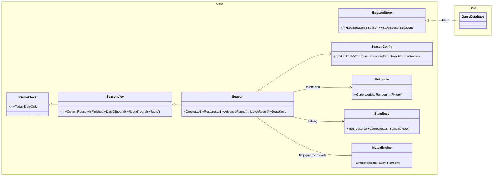

# Competição do M2 (calendário, rodada, tabela e temporada salva): plano

> **Para o Claude:** SUB-SKILL OBRIGATÓRIA: use executing-plans para implementar este plano tarefa por tarefa, com TDD (teste primeiro).

**Objetivo:** a Série A inteira jogável no Core: relógio, calendário de 38 rodadas, simulação da rodada, tabela com o desempate do regulamento e, no PR D, a temporada salva no banco.

**Arquitetura:** tudo novo no Core fica em `DonoDaBola.Core.Competition`, em C# puro e em memória. O Data só grava e lê a temporada (esquema v2). O Mateus lê pela interface `ISeasonView` e avança com `Season.AdvanceRound()`.

**Branches:** PR C `feature/calendario-e-tabela` → `main`; PR D `feature/temporada-persistida` → `feature/calendario-e-tabela`.

---

## Ajustes aprovados em 22/10

1. O modo `--temporada` do Sandbox vem no **PR C**, em memória. O PR D só acrescenta `--db`, salvar e continuar.
2. **Artilharia:** a temporada guarda os gols (jogador, minuto, clube) e a `ISeasonView` expõe `TopScorers(limit)`. No PR D, os gols vão para a tabela `season_goal` do esquema v2.
3. **Gravação atômica:** a rodada é gravada numa única transação, com os 10 jogos e os gols ou nada. Um teste simula a falha no meio da gravação. Os cartões vão exigir a contagem por clube e por jogo (migração v3).
4. **Relógio:** antes do início, `Today` é a data da 1ª rodada; no meio, a data da próxima rodada; depois da 38ª, continua na data da 38ª. `AdvanceRound()` depois da 38ª lança `InvalidOperationException`.
5. `ISeasonView.MatchesOf(clubId)`: os 38 jogos do clube, com data e placar.
6. **Testes extras:**
   - valor de referência fixo da seed derivada;
   - Spearman medido sobre a posição média nas 20 seeds (resultado: −0,99);
   - tabela no meio da temporada, com o confronto direto só sobre jogos já disputados.

## Regras confirmadas (Etapa 1, 22/10)

Fonte: REC Série A 2026 da CBF (v15/12/2025).
- **Formato (Art. 3º e 14):** 20 clubes, turno e returno, 38 rodadas.
- **Returno espelhado:** a rodada 20 repete a rodada 1 com os mandos trocados. É escolha nossa; o REC não define isso.
- **Pontuação:** vitória 3, empate 1, derrota 0.
- **Desempate (Art. 15):** vitórias, saldo, gols pró, confronto direto (pontos e depois saldo nos dois jogos, só entre 2 clubes), cartões vermelhos, cartões amarelos e sorteio.
- **Zonas (Art. 6º a 8º), fixas:**
  - 1º ao 4º: Libertadores, fase de grupos;
  - 5º: Libertadores, fase preliminar;
  - 6º ao 11º: Sul-Americana;
  - 17º ao 20º: rebaixamento.
- **Pausa da Copa:** depois da rodada 18; a rodada 19 é em 22/07/2026 (fontes secundárias). Início, rodada da pausa e data de volta são **parâmetros**.

## Design

### Relógio
- `Season` implementa `IGameClock`. `Today` é a data da próxima rodada; com a temporada encerrada, é a data da rodada 38.
- Não há uma classe de relógio separada: a data do jogo é a data do calendário.
- A versão fixa para testes já existe: `FixedClock` em `DonoDaBola.Core.Tests/TestPlayers.cs`.
- O Sandbox e o guia trocam a data fixa `2026-01-01` por `season.Today`. O modo de partida avulsa usa `SeasonConfig.Default.Start`.

### Configuração
```csharp
public record SeasonConfig(DateOnly Start, int BreakAfterRound, DateOnly ResumeOn, int DaysBetweenRounds = 7)
{
    public static readonly SeasonConfig Default = new(new(2026, 1, 28), 18, new(2026, 7, 22));
}
```
- Rodada `r ≤ BreakAfterRound`: a data é `Start + 7·(r−1)`.
- Depois da pausa: `ResumeOn + 7·(r−BreakAfterRound−1)`.
- Com o padrão, a rodada 1 cai em 28/01, a 18 em 27/05, a 19 em 22/07 e a 38 em 02/12, que é o fim oficial.
- O construtor valida os parâmetros: a volta precisa ser depois da última rodada antes da pausa, e a pausa entre 1 e 37.

### Calendário: `Schedule.Generate(IReadOnlyList<string> clubIds, Random random)`
- Os ids são ordenados e embaralhados com o `random`. Mesma seed, mesmo calendário.
- O turno sai pelo método do círculo (tabela de Berger): um clube fica fixo e os outros giram. O mando do par alterna pela rodada e pela posição no círculo, o que reduz as sequências de mando igual.
- O returno espelha o turno com os mandos trocados. Isso garante, por construção, que cada par joga uma vez em casa e uma fora, e que cada clube faz 19 jogos em casa e 19 fora.
- Devolve 380 `Fixture(int Round, int Index, string HomeId, string AwayId)`.

### Rodada e temporada: `Season`
- `Season.Create(clubs, seed, config)` gera o calendário e o sorteio de desempate.
- `Season.Restore(clubs, seed, config, matches, drawKeys)` remonta uma temporada salva (PR D).
- `AdvanceRound()` simula os 10 jogos da rodada atual e devolve os `MatchResult` completos, com eventos, para a narração.
- **Seed de cada jogo:** `unchecked(seed * 1_000_003 + round * 1_009 + index)`, com aritmética fixa. Não use `HashCode.Combine`, que muda a cada execução do processo. Por isso a temporada é retomável: o jogo N da rodada R tem sempre a mesma seed.
- **Eventos:** só ficam em memória, no retorno de `AdvanceRound()`. A temporada guarda só o placar.
  - Os 380 jogos com eventos (cerca de 11 por jogo) fariam o save crescer à toa.
  - Quando existir o "clube do jogador" (M3), entra uma tabela `match_event` só para os jogos dele.
- **Sorteio estável:**
  - `Create` embaralha os ids ordenados com `new Random(seed)` e dá a cada clube uma chave de 0 a 19, sem repetição.
  - As chaves ficam na temporada (`DrawKeys`) e vão para o banco no PR D. A tabela nunca consome um `Random`.

### Tabela: `Standings.Compute(clubs, matches, drawKeys)`
- `StandingRow(Position, Club, Played, Won, Drawn, Lost, GoalsFor, GoalsAgainst, GoalDifference, Points, Zone)`.
- **Ordenação:** primeiro por pontos. Os empatados passam pela lista `Standings.TieBreakers`, na ordem do Art. 15.
  - Cada critério é um `TieBreaker(string Name, Func<StandingRow, TieContext, int> Key)`, em que a maior chave fica à frente.
  - O grupo é reparticionado critério a critério. Assim, o confronto direto só vale quando restam exatamente 2 empatados (§2º).
- **Lista atual:** vitórias, saldo, gols pró, confronto direto (pontos), confronto direto (saldo) e sorteio.
- **Cartões:** os vermelhos e os amarelos entram antes do sorteio quando existirem (M2, eventos novos), com uma linha cada na lista e sem refatoração.
- `Zone`: `None`, `Libertadores`, `LibertadoresPreliminary`, `SulAmericana`, `Relegation`, pela posição final.

### Contrato do Mateus (somente leitura)
```csharp
public interface ISeasonView : IGameClock
{
    int CurrentRound { get; }          // próxima rodada a jogar (1..38); 39 = encerrada
    bool IsFinished { get; }
    DateOnly DateOf(int round);
    IReadOnlyList<SeasonMatch> Round(int round);   // jogos da rodada, com placar se já jogados
    IReadOnlyList<SeasonMatch> MatchesOf(string clubId); // os 38 jogos do clube
    IReadOnlyList<StandingRow> Table();            // tabela atual, já ordenada e com as zonas
    IReadOnlyList<TopScorer> TopScorers(int limit = 20);
}
public record SeasonMatch(int Round, int Index, DateOnly Date, Club Home, Club Away, int? HomeGoals, int? AwayGoals);
```
- Avançar: `IReadOnlyList<MatchResult> season.AdvanceRound()`.
- Alternativa mais enxuta, adotada: **não criar um `ISeasonRunner`**, porque ele teria uma única implementação. Quem tem a `Season` avança, e quem só mostra recebe `ISeasonView`.

### Persistência (PR D): esquema v2
```sql
CREATE TABLE season (
    id                  INTEGER PRIMARY KEY CHECK (id = 1),       -- uma temporada por save (multitemporada: ⏳)
    seed                INTEGER NOT NULL,
    start_date          TEXT NOT NULL,
    break_after_round   INTEGER NOT NULL CHECK (break_after_round BETWEEN 1 AND 37),
    resume_date         TEXT NOT NULL,
    days_between_rounds INTEGER NOT NULL CHECK (days_between_rounds > 0)
) STRICT;
CREATE TABLE season_club (
    club_id   TEXT PRIMARY KEY REFERENCES club(id),
    draw_key  INTEGER NOT NULL UNIQUE
) STRICT;
CREATE TABLE season_goal (
    round      INTEGER NOT NULL,
    idx        INTEGER NOT NULL,
    minute     INTEGER NOT NULL CHECK (minute BETWEEN 1 AND 90),
    club_id    TEXT NOT NULL REFERENCES club(id),
    player_id  TEXT NOT NULL REFERENCES player(id),
    FOREIGN KEY (round, idx) REFERENCES season_match(round, idx)
) STRICT;
CREATE TABLE season_match (
    round       INTEGER NOT NULL CHECK (round BETWEEN 1 AND 38),
    idx         INTEGER NOT NULL CHECK (idx BETWEEN 0 AND 9),
    home_id     TEXT NOT NULL REFERENCES club(id),
    away_id     TEXT NOT NULL REFERENCES club(id),
    home_goals  INTEGER CHECK (home_goals >= 0),
    away_goals  INTEGER CHECK (away_goals >= 0),
    PRIMARY KEY (round, idx),
    CHECK (home_id <> away_id),
    CHECK ((home_goals IS NULL) = (away_goals IS NULL))
) STRICT;
```
- **Relógio:** o estado não tem coluna. A rodada atual é a primeira sem placar, e a data sai da configuração. Assim não há dois valores para manter em sincronia.
- **O calendário é gravado** (380 linhas). Se o gerador mudar, um save antigo mantém o calendário dele.
- **Migração v1 → v2:** só cria as tabelas novas; clubes e jogadores ficam intocados. Bancos e saves v1 sobem sozinhos: `Open` e `SaveGameStore.Load` já chamam `Migrate`.
- **Contrato no Core:** `ISeasonStore { Season? LoadSeason(); void SaveSeason(Season season); }`, implementado pelo `GameDatabase`.
  - `SaveSeason` grava tudo numa transação e é idempotente.
  - Fluxo da interface: `AdvanceRound()`, depois `db.SaveSeason(season)` e, quando o jogador pedir, `saves.Save(slot)`.

### Sandbox (PR C; persistência no PR D)
- `--temporada [--seed n]` cria a temporada com os clubes do banco e simula as 38 rodadas.
- Imprime a tabela final (posição, sigla, P, J, V, E, D, GP, GC, SG e zona), o campeão, os rebaixados, a média de gols por jogo e o tempo gasto.
- Também mostra os 5 primeiros da artilharia.
- No PR C, fica em memória. No PR D, com `--db`, grava a temporada e permite parar e continuar.

## Diagrama



## Testes (TDD)

**PR C (`DonoDaBola.Core.Tests`):**
- **Calendário:**
  - 38 rodadas e 380 jogos;
  - cada par joga 2 vezes, uma em casa e uma fora;
  - cada clube faz 19 jogos em casa e 19 fora;
  - nenhum clube repete na rodada;
  - o returno é o espelho do turno;
  - no máximo 2 jogos seguidos com o mesmo mando dentro de cada turno e no máximo 3 na virada (limite medido na implementação; se o algoritmo der menos, o teste aperta);
  - mesma seed, mesmo calendário; seed diferente, calendário diferente.
- **Datas:** a rodada 1 cai em 28/01, a 18 em 27/05, a 19 em 22/07 e a 38 em 02/12. Com outra configuração, as datas mudam. Configuração inválida lança erro.
- **Tabela:**
  - vitória vale 3, empate 1 e derrota 0;
  - J, V, E, D, GP, GC e SG batem com os resultados.
- **Desempate:** um caso montado à mão para cada critério, em que os anteriores empatam:
  - vitórias, saldo e gols pró;
  - confronto direto por pontos e confronto direto por saldo;
  - confronto direto ignorado com 3 empatados;
  - sorteio.
- **Sorteio estável:** a mesma ordem em leituras repetidas da `Table()` e numa `Season.Restore` com as mesmas `DrawKeys`.
- **Zonas:** posições 1–4, 5, 6–11, 12–16 (`None`) e 17–20.
- **Temporada:**
  - mesma seed, mesma tabela final;
  - 380 jogos em menos de 5 s;
  - em 20 seeds, com os clubes do `LeagueGenerator` (níveis 15 a 8), a correlação de Spearman entre o nível e a posição média passa de 0,7, e o campeão não é sempre o mesmo clube.
- **Retomada em memória:** simular 19 rodadas, fazer `Restore` com as partidas e as chaves e simular o resto dá a mesma tabela final da temporada direta.
- **Relógio:** `Today` avança a cada rodada, e um jogador que faz aniversário no meio da temporada tem `AgeOn(season.Today)` maior no fim do que no início.
- **`AdvanceRound()`** com a temporada encerrada lança `InvalidOperationException`.

**PR D (`DonoDaBola.Data.Tests`):**
- **Migração:** um banco v1 criado à mão (só `Migrations[0]`, com clubes) abre na v2 com clubes e jogadores intactos, e `UserVersion` vale 2.
- **Temporada salva:** `SaveSeason`, depois `LoadSeason` e continuar até o fim dá exatamente a mesma tabela final de uma temporada sem interrupção. O sorteio fica igual depois de salvar e carregar.
- **Save no meio da temporada:**
  - fazer `SaveGameStore.Save` na rodada 19, avançar mais rodadas e fazer `Load` volta para a rodada 19;
  - continuar a partir dali dá a mesma tabela final;
  - um save v1 carregado sobe para a v2.
- **Banco sem temporada:** `LoadSeason()` devolve `null`.
- **Sandbox:** o teste de narração continua; o modo `--temporada` é verificado rodando de verdade.

## Pull requests

| PR | Conteúdo |
|---|---|
| **C** `[Competição]` | `Competition/` no Core (config, calendário, `Season`, `Standings`, `ISeasonView`, artilharia), testes e `--temporada` no Sandbox. Também: ADR 0004, a seção 12 do plano de 21/10 atualizada, `hugo.md` (reconciliação e "Competição (Mateus)"), a regra nova do CLAUDE.md (diff mostrado antes) e o Sandbox lendo a idade em `SeasonConfig.Default.Start` |
| **D** `[Temporada]` | Migração v2 (com `season_goal`), `ISeasonStore` no Core e no `GameDatabase`, gravação atômica da rodada com teste de falha, testes do Data, `--db` e retomada no `--temporada`, `hugo.md` |

## Fora do escopo
- Cartões e lesões (M2, próximo bloco). Os critérios 5 e 6 do desempate entram com eles.
- Repasse de vagas por Copa do Brasil ou título continental: não simulamos essas competições.
- Multitemporada, rebaixamento e acesso aplicados à temporada seguinte (⏳).
