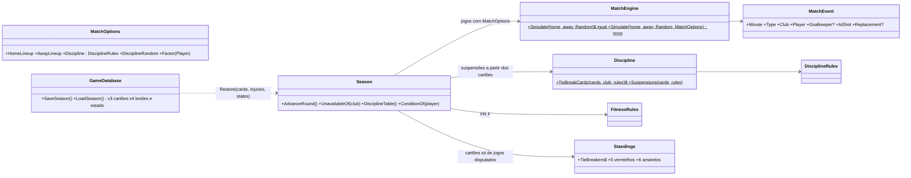

# Profundidade da simulação no M2 (cartões, suspensões, lesões, condição e moral): plano

> **Para o Claude:** SUB-SKILL OBRIGATÓRIA: use executing-plans para implementar este plano tarefa por tarefa, com TDD (teste primeiro).

**Objetivo:** a partida passa a ter cartões e lesões, e a temporada passa a ter suspensões, indisponíveis, condição física e moral, com os critérios 5 e 6 do desempate. Tudo deve continuar reprodutível pela seed e retomável pelo save.

**Arquitetura:**
- O `Player` continua estático.
- O estado que muda na temporada vive em `Season`, por id de jogador, e no banco.
- O motor ganha uma sobrecarga com opções. O `MatchEngine.Simulate(home, away, random)` atual **não muda**.

**Branches:**
- PR E: `feature/cartoes-e-suspensoes` → `main`.
- PR F: `feature/lesoes-condicao-moral` → `main`. Começa da `main` só depois do merge do PR E.

---

## Regras adotadas (Etapa 1, 27/10)

O Manual de Competições CBF 2026 **não foi encontrado**, então estas não são regras confirmadas da CBF: vêm de regulamentos de federações de 2026 (FGF, FMF, FPF-PE), do REC da Copa do Brasil 2026 e de casos reais da Série A 2026 (ADR 0005).

- **3º amarelo:** suspende 1 jogo. Os amarelos não zeram na temporada; a série recomeça depois de cumprida a suspensão.
- **Vermelho direto e segundo amarelo:** suspendem 1 jogo cada. Os dois amarelos da expulsão por segundo amarelo **não contam** para a série de três.
- **Desempate (critérios 5 e 6):** a expulsão por segundo amarelo conta como **1 vermelho e 1 amarelo**. É escolha nossa; o Art. 15 não define.
- **Faixas aceitáveis por jogo, somando os dois times:**
  - amarelos: 4,5 a 6,0 (referência 5,4, ou cerca de 2,7 por time);
  - vermelhos: 0,15 a 0,40 (referência 0,25 a 0,28).
- **Lesões:** de 12 a 28 por clube nas 38 rodadas (referência de cerca de 19). A taxa e a duração são parâmetros.
  - A duração máxima de 6 rodadas deixa as lesões longas de fora (ADR 0005).
  - A média de indisponíveis será conferida pela métrica do Sandbox.

## Regressão (antes de mexer no motor)

- **Referência da `main` (`6676904`):** um arquivo de teste guarda o placar e a sequência de gols (minuto, clube e jogador) de 20 partidas.
  - Clubes do `LeagueGenerator(new Random(7))`: os pares `clu01×clu20`, `clu02×clu19` e assim por diante, além dos invertidos.
  - Seeds de 1 a 20.
- **Tabela final da temporada, seed 42:** com a liga gerada (Core.Tests) e com o `seed.json` (Data.Tests).
- **Os testes de regressão** usam a sobrecarga nova do motor com estado neutro e disciplina desligada (`DisciplineRules.Off`) e exigem resultado **idêntico** ao de referência.
- **Garantia extra:** com os cartões ligados, um jogo **sem vermelho** tem o mesmo placar e os mesmos gols da referência. O amarelo não muda a força do time, e os cartões usam outra sequência aleatória.
- **O que muda na calibração, e por quê:** uma temporada com tudo ligado terá outra tabela, porque o vermelho enfraquece o time e o suspenso fica fora. A média de gols deve mudar pouco; a medição em 20 seeds sai no PR, com a explicação.

## Design

### Sequências aleatórias separadas
- **Gols:** continuam usando o `Random` recebido (no `Season`, `new Random(MatchSeed(...))`), sem nenhuma chamada a mais.
- **Cartões:** `new Random(Season.SubSeed(matchSeed, 1))`.
- **Lesões na partida:** `SubSeed(matchSeed, 2)`.
- **Lesões em treino:** `SubSeed(roundSeed, 3)`.
- A fórmula `SubSeed(seed, stream) = unchecked(seed * 31 + stream * 7_919)` tem um teste com valor de referência, como o `MatchSeed`.

### Configuração (parâmetros, nada de constante solta)
```csharp
// PR E
public sealed record DisciplineRules(
    int YellowsForSuspension = 3,
    int RedCardSuspension = 1,
    int SecondYellowSuspension = 1,
    bool SecondYellowCountsAsYellow = true,   // desempate: true = 1 vermelho + 1 amarelo; false = só 1 vermelho (teste mostra os dois)
    double YellowPerTeamMinute = 0.03,        // ≈ 2,7 por time por jogo, antes do peso por agressividade
    double DirectRedPerTeamMinute = 0.0007,   // calibrado: 0,27 vermelho por jogo (0,14 por 2º amarelo + 0,13 direto)
    double BookedCaution = 0.15)              // quem já tem amarelo pesa menos no sorteio (sem isso: 0,63 2º amarelo por jogo)
{
    public static readonly DisciplineRules Default = new();
    public static readonly DisciplineRules Off = new(YellowPerTeamMinute: 0, DirectRedPerTeamMinute: 0);
}
// PR F
public sealed record FitnessRules(
    double MatchInjuryPerTeamMinute,  // lesão em jogo
    double TrainingInjuryPerPlayerRound,
    int MinInjuryRounds = 1, int MaxInjuryRounds = 6,  // mais lesões curtas que longas
    double FatiguePer90 = 25, double RecoveryShare = 0.6,    // condição 0–100; recupera 60% do que falta por rodada
    double MoraleWin = 5, double MoraleLoss = -5, double MoraleDecay = 0.1,  // moral 0–100, volta ao neutro
    double ConditionWeight = 0.2, double MoraleWeight = 0.05);  // pesos na nota efetiva
```
- As regras **não são gravadas no banco**. Elas valem para o jogo inteiro, e um save antigo usa as regras da versão do jogo que o carrega.

### Estado por jogador na temporada
| Campo | Limites | Neutro | PR |
|---|---|---|---|
| `YellowCards` (série atual) | 0 a 2 | 0 | E |
| `SuspendedRounds` (rodadas que faltam cumprir) | ≥ 0 | 0 | E |
| `InjuredRounds` | ≥ 0 | 0 | F |
| `Condition` | 0 a 100 | 100 | F |
| `Morale` | 0 a 100 | 50 | F |

- **No PR E, a disciplina é derivada:** amarelos e suspensões saem do **histórico de cartões gravado**, reprocessado em ordem. Não há tabela de estado de disciplina, então não há duas fontes da verdade.
- **No PR F**, condição, moral e lesão dependem dos minutos jogados, que não são gravados. Por isso vão para um retrato do estado depois da última rodada gravada.
- **Cumprimento da suspensão:** todo clube joga em toda rodada, então ela é contada por rodada. Antes da rodada `r`, quem tem `SuspendedRounds > 0` fica fora; depois da rodada, o contador diminui 1.

### Eventos novos e compatibilidade (o que muda para o Mateus)
- **`MatchEventType`** ganha `YellowCard`, `SecondYellow` (expulsão por segundo amarelo) e `RedCard` (vermelho direto) no PR E, e `Injury` no PR F. Os valores atuais (`Goal`, `Save`, `Miss`) **não mudam**.
- **`MatchEvent.Goalkeeper`** passa a ser `Player?`. Ele é **nulo nos eventos que não são finalização**. Isso não quebra a compilação, só gera um aviso de nulo em quem usa `e.Goalkeeper.Name`.
- **Novo `MatchEvent.IsShot`:** é `true` para `Goal`, `Save` e `Miss`. **Atenção:** quem conta finalizações com `Events.Count` precisa filtrar por `IsShot`; o Sandbox faz isso.
- **PR F:** o `MatchEvent` ganha `Player? Replacement { get; init; }`, com quem entrou no lugar do lesionado (ou nulo se o time ficou com um a menos).
- **Ordem dos eventos:** no mesmo minuto, a finalização vem antes do cartão e da lesão.
- **`MatchResult`** não muda. As escalações iniciais continuam em `HomeLineup` e `AwayLineup`.
- A `NarrationFormatter` do Sandbox ganha as frases novas, e o teste do enum continua valendo. **A cópia da Stride não quebra**, porque o caso padrão dela não lança.

### Efeito dentro da partida
- **Cartão:** a cada minuto, cada time sorteia (com a sequência de cartões) um amarelo e um vermelho direto, cada um com sua taxa.
  - Quem recebe é sorteado entre os 11 em campo, com peso `Aggression` × função na escalação (zagueiro 1,5, meia 1,2, atacante 0,8, goleiro 0,2).
  - O segundo amarelo do mesmo jogador gera `SecondYellow`.
  - ponytail: o goleiro só recebe amarelo, não vermelho. Isso evita improvisar um goleiro sem substituições; revisar quando houver substituições (M3).
- **Expulsão:** o time perde o jogador até o fim.
  - Cada expulsão multiplica defesa, meio e ataque por `RedCardStrength = 0,85`, uma constante no topo do `MatchEngine`.
  - O expulso não finaliza mais.
- **Lesão (PR F):** o jogador sai, e entra automaticamente o melhor reserva disponível da mesma posição (evento com `Replacement`).
  - Sem reserva da posição, entra o melhor reserva disponível qualquer.
  - Sem reserva nenhum, o time segue com um a menos, com o mesmo fator do vermelho.
  - O goleiro lesionado é trocado pelo goleiro reserva; se não houver, o melhor reserva disponível vai para o gol (nota de goleiro dele).
  - Substituição escolhida pelo jogador fica para o M3.

### Desempenho (PR F)
- **Nota efetiva:**
  `nota × (1 − ConditionWeight × (1 − condição/100)) × (1 + MoraleWeight × (moral − 50)/50)`
  - O fator vai de 0,8 a 1,05, com os limites aplicados.
  - Em estado neutro, o fator é **exatamente 1**, então os cálculos saem iguais.
- **Escalação:** usa a nota efetiva. Um titular cansado pode dar lugar ao reserva, e o rodízio aparece sozinho.
- **Entre rodadas:**
  - quem jogou perde `FatiguePer90 × minutos/90` de condição;
  - todos recuperam `RecoveryShare` (60%) do que falta para 100.
    - **Por que não uma recuperação fixa:** com `FatiguePer90 = 25` e uma recuperação fixa de 20, quem joga sempre perde 5 pontos líquidos por rodada, chega perto de 0 na rodada 20 e fica com a nota efetiva 20% menor.
    - **Recuperação proporcional:** tem equilíbrio estável. Quem joga sempre termina em `c = 100 − 0,4·(100 − c + 25)`, ou seja, cerca de 83.
    - **Conferência no Sandbox:** o Sandbox do PR F mostra a condição média dos titulares por rodada, e ela precisa ficar entre 80 e 95;
  - a moral do elenco sobe `MoraleWin` na vitória e cai `MoraleLoss` na derrota, e volta ao neutro `MoraleDecay` por rodada;
  - a duração da lesão diminui 1 por rodada.
- **Lesões fora de jogo: sim.**
  - O levantamento do ge conta baixas médicas de treino e de jogo, todas as que tiraram o jogador de ao menos uma partida oficial. Só com lesões em jogo, a meta de cerca de 19 por clube exigiria uma taxa irreal dentro da partida.
  - Proposta de divisão: cerca de 60% em jogo e 40% em treino. O treino sorteia, entre os jogadores disponíveis, uma vez por rodada.

### Escalação
- `Lineup.Pick442(club)` **continua igual**.
- **Nova sobrecarga:** `Lineup.Pick442(Club club, IReadOnlySet<string> unavailable, Func<Player, double>? factor = null)`.
- **Sempre 11:**
  - se faltar gente numa posição, vale o fallback atual;
  - se houver menos de 11 disponíveis, completa com os indisponíveis de maior nota. ponytail: com elencos de 28 isso é quase impossível; o teste força.
- **`Lineup.Bench`:** os disponíveis fora do time, para as reposições do PR F. É um membro novo e não muda os atuais.

### Desempate (critérios 5 e 6)
- **Um único método** conta os cartões que valem para o desempate, com teste próprio:
  `Discipline.TieBreakCards(IEnumerable<SeasonCard> cards, string clubId, DisciplineRules rules) => (Reds, Yellows)`
  - `RedCard` e `SecondYellow` valem 1 vermelho cada;
  - `YellowCard` vale 1 amarelo, inclusive o 1º amarelo de quem depois foi expulso;
  - o 2º amarelo, que vira vermelho, não gera evento de amarelo, então a expulsão conta 1 vermelho e 1 amarelo.
- **Comportamento:** `Season.Create` usa `DisciplineRules.Default`. Os testes de regressão usam `Off` explicitamente. Os que fixavam tabela ou campeão são atualizados com os novos valores. O PR traz a comparação `Off` × `Default` em 20 seeds: campeão, pontos do 1º e do 17º e gols por jogo.
- `Standings.TieBreakers` ganha `"Cartões vermelhos"` e `"Cartões amarelos"` (menos é melhor) antes do `"Sorteio"`. Eles contam só os cartões de jogos já disputados.
- O `TieContext` ganha `Cards`, um membro com valor padrão, sem mudar os atuais.

### `ISeasonView`: acréscimos (só leitura)
```csharp
IReadOnlyList<Unavailable> UnavailableOf(string clubId);   // PR E: suspensos; PR F: + lesionados
IReadOnlyList<DisciplineRow> DisciplineTable();            // PR E: por clube, ordenado por menos vermelhos e depois menos amarelos
PlayerCondition ConditionOf(string playerId);              // PR F
public record Unavailable(Player Player, UnavailableReason Reason, int ReturnRound); // Suspended, Injured
public record DisciplineRow(Club Club, int Yellows, int Reds, int Suspensions);
public record PlayerCondition(int Condition, int Morale, int YellowCards); // PR F
```
- `Unavailable`, `DisciplineRow` e `PlayerCondition` são nomes provisórios.
- `ReturnRound` é a primeira rodada em que o jogador volta a poder jogar.

### Persistência (tabelas novas apenas)
- **v3, PR E:**
  - `season_card(round, idx, minute, club_id, player_id, kind CHECK IN ('yellow','second_yellow','red'))`;
  - chave estrangeira para `season_match`, `club` e `player`.
- **v4, PR F:**
  - `season_injury(round, idx NULL para treino, minute NULL, club_id, player_id, rounds)`;
  - `season_player_state(player_id PK, condition CHECK 0–100, morale CHECK 0–100, injured_rounds ≥ 0)`, um retrato depois da última rodada gravada.
- **Gravação:** `SaveSeason` grava placares, gols, cartões, lesões e o retrato do estado **numa única transação**.
- **`Season.Restore`:** ganha `cards` (e, no PR F, `injuries` e `states`) como parâmetros opcionais. Uma temporada v2 já salva carrega sem cartões e com estado neutro.
- **Migração:** banco v2 com temporada pela metade abre na v3 (e depois na v4) com tudo intacto, e continua.

### Sandbox
- **Partida:** a narração mostra cartões e lesões, com o substituto.
- **`--temporada`**, resumo de disciplina e condição:
  - amarelos e vermelhos por jogo, somando os dois times;
  - cartões por clube;
  - suspensões por acúmulo de amarelos, por clube;
  - lesões por clube (PR F);
  - média de indisponíveis (lesão ou suspensão) por clube por rodada.

## Diagrama



## Testes (TDD)

**PR E:**
- **Regressão:**
  - os 20 placares e gols de referência saem idênticos com `DisciplineRules.Off`;
  - a tabela final da seed 42 sai idêntica com a disciplina desligada (Core com a liga gerada; Data com o `seed.json`);
  - um jogo com cartões e sem vermelho tem os mesmos gols da referência.
- **Cartões:**
  - o segundo amarelo vira `SecondYellow`;
  - o vermelho e o segundo amarelo suspendem 1 rodada;
  - o 3º amarelo suspende 1 rodada e zera a série;
  - os dois amarelos da expulsão não contam para a série;
  - o suspenso fica fora da rodada seguinte e volta depois;
  - o expulso não finaliza mais, e o time dele finaliza menos (medido em muitos jogos).
- **Desempate:**
  - casos montados à mão para o critério 5 e para o 6;
  - teste próprio do `TieBreakCards` (a expulsão por segundo amarelo vale 1 vermelho e 1 amarelo);
  - remover um critério por vez quebra algum teste;
  - no meio da temporada, só contam os cartões já recebidos.
- **Médias em 20 seeds, somando os dois times:** de 4,5 a 6,0 amarelos e de 0,15 a 0,40 vermelho por jogo.
- **Escalação:** sempre 11, mesmo com o goleiro suspenso ou com 20 indisponíveis.
- **Retomada:** salvar na rodada 19, carregar e continuar dá a mesma tabela, os mesmos cartões e as mesmas suspensões de uma temporada direta (em memória e no banco).
- **Atomicidade:** uma falha forçada ao gravar um cartão no meio da rodada não deixa nem placar nem cartão dessa rodada.
- **Migração:** banco v2 com temporada pela metade abre na v3 intacto e continua.
- **Desempenho:** 380 jogos em menos de 5 s.

**PR F:**
- **Lesões:** o lesionado fica fora pelo número de rodadas sorteado e depois volta; o reposto da mesma posição entra; sem reserva, o time fica com um a menos; o goleiro lesionado é reposto.
- **Escalação:** 11 com baixas em massa.
- **Condição e moral:**
  - menos condição dá nota efetiva menor, dentro dos limites;
  - o descanso recupera;
  - a moral sobe com vitória, cai com derrota e volta ao neutro;
  - em estado neutro, o fator é exatamente 1.
- **Médias:** de 12 a 28 lesões por clube por temporada, em várias seeds.
- **Retomada, atomicidade e migração:** iguais às do PR E, agora com lesões e estado (v3 → v4).
- **Desempenho:** 380 jogos em menos de 5 s.

## Pull requests
| PR | Conteúdo |
|---|---|
| **E** `[Disciplina]` | Testes de regressão (primeiro commit); `DisciplineRules`; eventos de cartão com sequência própria; `IsShot`; `Goalkeeper?`; expulsão no motor; `Lineup.Pick442` com indisponíveis; suspensões; critérios 5 e 6; `UnavailableOf` e `DisciplineTable`; migração v3; Sandbox; ADR 0005; `hugo.md` |
| **F** `[Condição]` | `FitnessRules`; lesão em jogo e em treino com reposição; condição e moral na nota efetiva e na escalação; `ConditionOf`; migração v4; Sandbox; `hugo.md` ("Próximos passos do M4" e "Decisões tomadas" enxuta, com links para os ADRs) |

## Fora do escopo
- Substituições escolhidas pelo jogador e táticas (M3).
- Penas do tribunal da CBF além da suspensão automática.
- Vermelho para goleiro (até existirem substituições).
